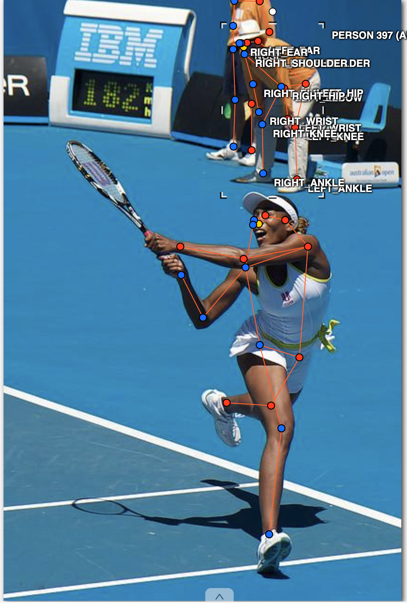
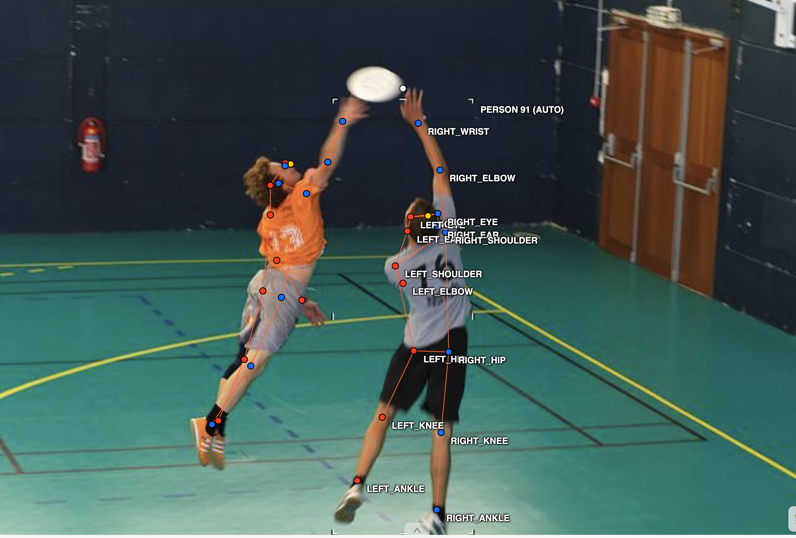
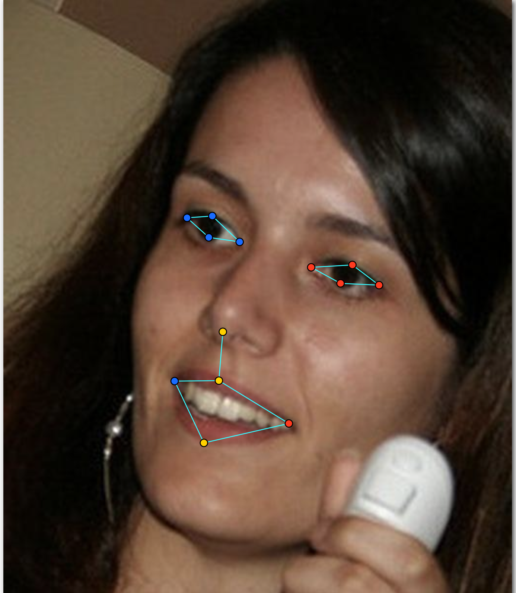
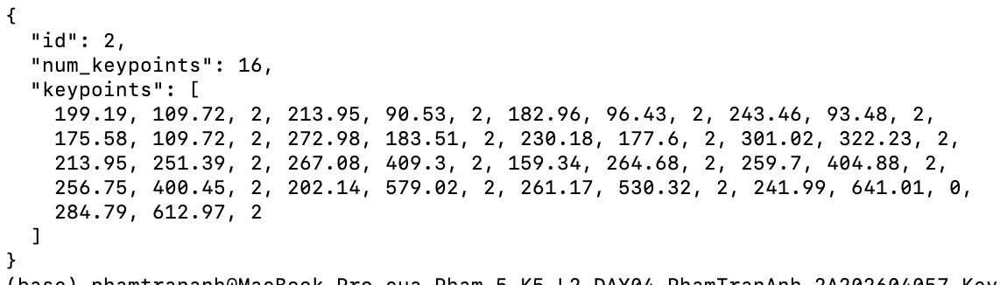

# Báo cáo cá nhân — PhamTranAnh · 2A202604057

Dữ liệu: 12 ảnh người COCO 2017 (train2017 và val2017) (Lin et al., 2014) và 8 ảnh chân dung Wikimedia Commons, chỉ dùng trong lớp.

## 0. Thông tin học viên

- Họ tên: PhamTranAnh
- MSSV: 2A202604057
- Email: 26ai.anhpt8@vinuni.edu.vn
- Link repository: https://github.com/GemmaP512/K5-L2B-DAY04-PhamTranAnh-2A202604057-KeypointPose
- Phiên bản CVAT (Help → About): v2.74.1
- Máy: hệ điều hành macOS 15.4.1 · RAM 8 GB · chạy CVAT chế độ đầy đủ
- Bộ ảnh (`src/exports/assignment.json` do `lab.py setup` tạo): Có (pool `d04-k5-v2`, ID job người: 12, ID job mặt: 13)
- Giờ bắt đầu: 4h
- Giờ kết thúc: 7h30

## 1. Kiểm tra label (CP0)

| Label | Kiểu | Số điểm | Tên điểm đúng bảng của lab? | Đúng thứ tự? | Số cạnh |
|---|---|---:|---|---|---:|
| `person` | Skeleton | 17 | Khớp schema trong repo | Khớp schema trong repo | 19 |
| `face` | Skeleton | 13 | Khớp schema trong repo | Khớp schema trong repo | 13 |

Mẫu `person` dựng theo người quay mặt về camera (các điểm `left_*` nằm bên phải khung mẫu)? **Chưa xác nhận trong trình cấu hình.**

Cách đổi cờ `occluded` / `outside` cho **một điểm** trên phiên bản CVAT này (một câu): Rê chuột lên điểm rồi bấm `Q` để bật hoặc tắt `occluded` (`v=1`), hoặc `O` để bật hoặc tắt `outside` (`v=0`).

## 2. Số lượng đã gán và thời gian (CP1, CP2)

| Nhóm ảnh | Số ảnh | Số skeleton đã gán | Số người dưới 60 px (không gán) | Số poster / gương / màn hình bỏ qua | Thời gian (phút) |
|---|---:|---:|---:|---:|---:|
| `easy` | 5 | 5 | | | |
| `occluded` | 3 | 8 | | | |
| `back` | 2 | 4 | | | |
| `small` | 1 | 7 | | | |
| `crowd` | 1 | 3 | | | |
| `faces` | 8 | 8 | — | | |

- Số ảnh người đã xong ở mốc phút 105: 10 ảnh (trên tổng số 12 ảnh được giao)
- Thời gian thực tế (phút): CP1: 10 phút · CP2: 20 phút · CP3: 30 phút
- Ảnh tốn thời gian nhất là ảnh nào, vì sao?
  Ảnh có hai người đàn ông và nhiều khớp bị che. Tên ảnh: chưa ghi.

## 3. Bảng ca khó (CP1, CP2)

Mỗi điểm bạn phân vân một dòng, nhất là phân vân giữa `v = 1` và `v = 0`, hoặc không chắc hướng người.

| Ảnh | Người / mặt | Điểm | Cờ đã chọn | Phân vân giữa | Lý do chọn |
|---|---|---|---:|---|---|
| `000000019754.jpg` | Người #1 | `left_wrist` / `right_wrist` | `v=2` | Gán trái/phải (`lr_swap`) hay tay bắt chéo thật | Terminal báo cặp cổ tay ngược phía so với các cặp còn lại; cần đối chiếu ảnh gốc trước khi kết luận. |
| `000000122199.jpg` | Người #1 | `left_knee` / `right_knee` | `v=2` | Gán trái/phải (`lr_swap`) hay chân bắt chéo thật | Terminal báo cặp gối ngược phía; cả hai điểm hiện có cờ nhìn thấy. |
| `000000122199.jpg` | Người #1 | `left_ankle` | `v=0` | `v=1` (khuất) hay `v=0` (ngoài khung) | Ở bản xuất trước điểm nằm ngoài khung nhưng để `v=2`; đã sửa thành `v=0`, hiện checker không còn báo lỗi này. |
| `000000163118.jpg` | Người #1 | Các cặp trái/phải | Mũi và hai mắt: `v=2` | Người quay mặt hay quay lưng; có cần đổi trái/phải toàn người | Terminal thấy mũi và hai mắt `v=2` nhưng các điểm `left_*` ở bên trái ảnh; cần xem hướng cơ thể trong ảnh gốc. |
| `000000163118.jpg` | Người #2 | Các cặp trái/phải | Mũi và hai mắt: `v=2` | Người quay mặt hay quay lưng; có cần đổi trái/phải toàn người | Cùng cảnh báo như người #1; đây là gợi ý tự động, cần xác nhận bằng ảnh gốc. |
| `000000201702.jpg` | Người #1 | `left_ankle` | `v=2` | Khớp nhìn thấy sát mép (`v=2`) hay thực ra ngoài ảnh (`v=0`) | Checker ghi tọa độ `(486, 479)` sát mép; hiện vẫn để `v=2`, cần phóng to ảnh để xác nhận khớp còn trong khung không. |
| `000000480582.jpg` | Người #1 | Các cặp trái/phải | Mũi và hai mắt: `v=2` | Người quay mặt hay quay lưng; có cần đổi trái/phải toàn người | Terminal thấy mũi và hai mắt `v=2` nhưng các điểm `left_*` ở bên trái ảnh; cần xem hướng cơ thể trong ảnh gốc. |
| `000000522889.jpg` | Người #3 | `left_ankle` / `right_ankle` | `v=2` | Gán trái/phải (`lr_swap`) hay chân bắt chéo thật | Terminal báo cặp cổ chân ngược phía so với các cặp còn lại; cần kiểm lại tư thế trong ảnh. |
| `000000580257.jpg` | Người #1 | `left_ankle` / `right_ankle` | `v=2` | Gán trái/phải (`lr_swap`) hay chân bắt chéo thật | Terminal báo cặp cổ chân ngược phía so với các cặp còn lại; cần kiểm lại tư thế trong ảnh. |

Các dòng trên được tổng hợp từ cảnh báo của `check_submission.py` và trạng thái `v` trong ZIP. Cảnh báo chỉ là gợi ý cần tự đối chiếu ảnh gốc; chưa khẳng định nhãn trái/phải sai. Những cảnh báo về người dưới 60 px và skeleton gần trùng nhau cần ghi/đánh giá ở phần tự review.

## 4. Bảng tự review (CP3)

Danh sách rà soát gồm 5 ảnh người và 3 ảnh mặt, theo thứ tự ngược trong bộ ảnh đã chọn. Ba lỗi `vis_flag` được ghi từ một lần xuất trước và đã được xác nhận là đã sửa trong ZIP hiện có. Số thứ tự người ở ba dòng này theo log cũ. Với các dòng còn lại, cột cuối ghi trạng thái do người làm bài cung cấp. Dấu `—` cho biết báo cáo chưa ghi mã lỗi hoặc kết luận khi xem ảnh.

| Ảnh | Người / mặt | Điểm | Mã lỗi | Ghi chú | Đã sửa? |
|---|---|---|---|---|---|
| `000000522889.jpg` | Người #3 | Cặp cổ chân |  ok| Checker cảnh báo có thể đảo trái/phải. Xem tư thế hai chân để phân biệt với chân bắt chéo. | Đã sửa |
| `000000253584.jpg` | Người #2, #4, #5, #6, #7 | Toàn bộ skeleton | ok | Độ trải dọc lần lượt là 49, 1, 28, 27 và 7 px. Kiểm tra chiều cao từng người và xem họ có bị cắt khung không trước khi kết luận `extra`. | Đã sửa |
| `000000480582.jpg` | Người #1 | Các cặp trái/phải |  ok| Mũi và hai mắt có `v=2`, nhưng các điểm `left_*` nằm bên trái ảnh. Kiểm tra hướng thân người trước khi kết luận `lr_swap`. | Đã sửa |
| `000000163118.jpg` | Người #1 | Các cặp trái/phải |  ok| Checker cảnh báo hướng người dựa trên vị trí các điểm `left_*` và cờ của mũi, mắt. | Đã sửa |
| `000000163118.jpg` | Người #2 | Các cặp trái/phải |  ok| Kiểm tra hướng thân người và phía giải phẫu của vai, hông để xác nhận có đảo nhãn không. | Đã sửa |
| `000000122199.jpg` | Người #1 | `left_shoulder` | `vis_flag` | Điểm `(480, 214)` nằm ngoài ảnh và từng có `v=2`. ZIP hiện có ghi `v=0` tại điểm này. | Đã sửa |
| `000000122199.jpg` | Người #1 | `left_elbow` | `vis_flag` | Điểm `(483, 266)` nằm ngoài ảnh và từng có `v=2`. ZIP hiện có ghi `v=0` tại điểm này. | Đã sửa |
| `000000122199.jpg` | Người #2 | `left_ankle` | `vis_flag` | Điểm `(242, 641)` nằm ngoài ảnh và từng có `v=2`. ZIP hiện có ghi `v=0` tại điểm này. | Đã sửa |
| `face_105668.jpg` | Mặt | 13 điểm |  ok| Kiểm tra mí, khóe mắt và các điểm quanh miệng khi phóng to. | Đã sửa |
| `face_232598.jpg` | Mặt | 13 điểm |  ok| Kiểm tra thứ tự trái/phải và các điểm có thể bị che. | Đã sửa |
| `face_125051.jpg` | Mặt | 13 điểm |  ok| Kiểm tra vị trí các điểm và cờ hiển thị. | Đã sửa |

**Tổng hợp lỗi đã xác nhận trước khi sửa**

| `lr_swap` | `vis_flag` | `position` | `missing` | `extra` | `ok` |
|---:|---:|---:|---:|---:|---:|
| — | 3 | — | — | — | — |

**Phân biệt `v=1` và `v=0`**

Ba điểm ở `000000122199.jpg` nằm ngoài khung nên dùng `outside` (`v=0`). Cờ `occluded` (`v=1`) dùng khi khớp nằm trong ảnh, bị che nhưng vẫn ước lượng được vị trí đủ chắc chắn.

## 5. Kiểm file xuất và kết quả tự kiểm (CP4)

Tự kiểm tay trong file JSON:

| File | Người / mặt kiểm (ảnh, thứ tự) | Số phần tử `keypoints` | Điểm `outside` ra `v = 0`, `occluded` ra `v = 1`? | `num_keypoints` khớp? |
|---|---|---:|---|---|
| `PhamTranAnh_persons.zip` | `000000122199.jpg`, annotation ID 2 | 51 | `v=0`: 1, `v=1`: 0, `v=2`: 16 | Có, 16 điểm có `v>0` |
| `PhamTranAnh_persons.zip` | `000000393909.jpg`, annotation ID 16 | 51 | `v=0`: 11, `v=1`: 1, `v=2`: 5 | Có, 6 điểm có `v>0` |
| `PhamTranAnh_faces.zip` | `face_105668.jpg`, annotation ID 1 | 39 | `v=0`: 0, `v=1`: 0, `v=2`: 13 | Có, 13 điểm có `v>0` |

Sau khi xuất, CVAT ghi `occluded` thành `v = 1` và `outside` thành `v = 0`. Tọa độ của điểm `outside` trong file là `0, 0` hay tọa độ cũ? Trong bản xuất này, 77 điểm `v=0` vẫn có tọa độ cũ.

Trạng thái hai job trên CVAT theo ghi nhận của người làm bài: `completed`.

**Kết quả kiểm tra hai file ZIP hiện có**

```text
----- TÓM TẮT (dán vào báo cáo mục 5) -----
- File person: PhamTranAnh_persons.zip
  Số ảnh: 12 · số skeleton `person`: 27 · mỗi annotation 51 số
  Skeleton theo ảnh: 000000019754=1, 000000122199=2, 000000137767=1, 000000163118=2, 000000201702=1, 000000253584=7, 000000292999=1, 000000393909=4, 000000480582=2, 000000522889=3, 000000564304=1, 000000580257=2
  Cờ v: v=2 376 (82%) · v=1 6 (1%) · v=0 77 (17%)
  num_keypoints trung bình: 14.1
- File face: PhamTranAnh_faces.zip
  Số ảnh: 8 · số skeleton `face`: 8 · mỗi annotation 39 số
  Skeleton theo ảnh: face_105668=1, face_125051=1, face_232598=1, face_342273=1, face_356144=1, face_483667=1, face_559185=1, face_99874=1
  Cờ v: v=2 104 (100%) · v=1 0 (0%) · v=0 0 (0%)
  num_keypoints trung bình: 13.0
- Ghi chú: 77 điểm v = 0 vẫn mang tọa độ cũ (CVAT 2.x xuất như vậy; chuẩn COCO ghi 0, 0). Không phải lỗi: điểm v = 0 bị bỏ qua khi huấn luyện và khi chấm.
- Số [LỖI]: 0 · số [CẢNH BÁO]: 15
Kết quả: ĐẠT (đọc lại từng cảnh báo ở trên)
```

Lần xuất trước có ba lỗi điểm ngoài khung ở `000000122199.jpg`. Đối chiếu tọa độ trong ZIP hiện có cho thấy cả ba điểm đã có `v=0`.

Checker hiện còn 15 cảnh báo: 7 cảnh báo về trái/phải hoặc hướng người, 1 cảnh báo về cổ chân sát mép, 5 skeleton có độ trải dọc dưới 60 px và 2 cặp skeleton có thể bị trùng. Các cảnh báo cần được đối chiếu với ảnh trên CVAT để chốt kết luận.

## 6. Ảnh chụp màn hình

1. Label `person` trong label constructor (đủ 17 điểm có tên):

   

   

2. Một người quay lưng đã gán, cờ đã đặt:

   

   Nguồn: COCO 2017. Ghi tên ảnh và tập train2017 hoặc val2017 sau khi chụp.

3. Một khuôn mặt đã gán 13 điểm, phóng to vùng mắt:

   

   Nguồn: Wikimedia Commons. Ghi nguồn cụ thể theo ảnh đã chụp.

4. Một đoạn JSON xuất của một người:

   

   Nguồn: JSON xuất từ CVAT trong `PhamTranAnh_persons.zip`.

## 7. Tự đánh giá

1. Lỗi bạn mắc nhiều nhất hôm nay, và cách bạn sẽ tránh ở dự án thật:

   Tôi chưa kiểm tra kỹ cờ `occluded` và `outside`.

2. Một quy tắc bạn đề xuất thêm vào guideline (kèm ảnh ví dụ nếu có):

   Không có

3. Nhãn của bạn đi vào model ở đâu? Chọn một lỗi bạn đã sửa và nói nó sẽ làm model học sai thế nào (heatmap, trọng số trong loss, hay bước lật ảnh):

   Điểm `left_ankle` ở ảnh `000000122199.jpg` từng có `v=2` dù nằm ngoài khung. Nếu giữ cờ này, tọa độ sai có thể được dùng làm mục tiêu khi tạo heatmap. Đổi thành `v=0` để bỏ qua điểm đó khi tính loss.


## 8. Khó khăn và lỗi kỹ thuật

Bản xuất trước báo ba điểm ngoài khung có `v=2` ở `000000122199.jpg`: `left_shoulder`, `left_elbow` và `left_ankle`. Cả ba đã có `v=0` trong ZIP hiện có.


## 9. Tài liệu tham khảo và công cụ AI đã dùng

- Tài liệu lab: `docs/GUIDELINE.md`, `CHECKPOINTS.md`, `SUBMISSION.md`.
- Codex: hỗ trợ sử dụng CVAT, giải thích kết quả checker, đối chiếu ZIP và biên tập báo cáo.
